# Pata

Aplicativo que conecta o órgão fictício de proteção animal Pata a pessoas interessadas em adotar: de um lado, facilita o cadastro e a gestão dos cães e gatos disponíveis pelos responsáveis do órgão; do outro, ajuda quem quer adotar a encontrar e conhecer esses animais — funcionando como um pequeno marketplace de adoção.

Projeto da disciplina Desenvolvimento Móvel (Faculdade Serra Dourada, prof. Guibson Krause). Este repositório já passou por três entregas: Trabalho 1 (base Flutter), Trabalho 2 (autenticação com Firebase) e Trabalho 3 (Cloud Firestore e CRUD por usuário).

## Objetivo do aplicativo

A visão completa do produto é servir um órgão fictício de proteção animal (Pata): centralizar o cadastro dos cães e gatos recolhidos/disponíveis e permitir que qualquer pessoa consulte quais animais estão disponíveis para adoção, como um pequeno "marketplace" de adoção. O app terá dois perfis de uso: responsáveis pelo órgão, que cadastram e mantêm os dados dos animais, e adotantes, que apenas consultam os animais disponíveis.

No Trabalho 1, como contas de usuário ainda não faziam parte do escopo, o app implementou só a base do cadastro (a parte usada pelo perfil responsável): cadastrar, listar, ver detalhes e excluir animais. No Trabalho 2, essa base ganhou autenticação de verdade com Firebase Authentication: o app já distingue quem está autenticado de quem não está, e as telas internas ficaram protegidas. No Trabalho 3, os pets passaram a ser salvos no Cloud Firestore, vinculados à conta de cada usuário. A diferenciação entre os dois perfis (responsável x adotante) fica para o Trabalho 4.

## Tema/domínio escolhido

Gerenciador de cuidados com pets. Entidade principal: Pet. Nesta etapa, o cadastro é restrito a cães e gatos.

## Funcionalidades implementadas desde o Trabalho 1

- Onboarding de boas-vindas (3 slides em uma única tela, com PageView);
- Listagem dos pets cadastrados (apenas cães e gatos; no Trabalho 1 com dados mockados, a partir do Trabalho 3 vindos do Firestore);
- Cadastro de um novo pet, com validação dos campos obrigatórios (nome, espécie, sexo, raça, data de nascimento, peso e vacinação);
- Visualização dos detalhes de um pet;
- Edição e exclusão de um pet, com confirmação;
- Feedback visual (mensagens de sucesso e erro) em todas as ações;
- Navegação entre as telas com go_router.

## Autenticação (Trabalho 2)

- Cadastro de conta com e-mail e senha, com validação de formato de e-mail, senha mínima de 6 caracteres e confirmação de senha;
- Login com e-mail e senha, com mensagens de erro traduzidas (nunca uma exceção técnica do Firebase é mostrada direto ao usuário);
- Recuperação de senha por e-mail, usando o próprio Firebase;
- Logout, acessível pelo ícone de conta no canto superior direito da tela inicial (mostra o e-mail logado e a opção "Sair");
- Proteção de rotas: quem não está autenticado é redirecionado automaticamente para o login ao tentar acessar a listagem, o cadastro ou os detalhes de um pet; quem já está autenticado não consegue ficar "preso" nas telas de login/cadastro;
- Sessão persistida: ao reabrir o app já logado, uma tela de carregamento é exibida por um instante enquanto o Firebase confirma a sessão;
- Loading e bloqueio de múltiplos envios em toda operação assíncrona de autenticação.

Toda a lógica de autenticação fica isolada em `features/auth/`; nenhuma tela chama o Firebase diretamente.

## Cloud Firestore e CRUD por usuário (Trabalho 3)

Os pets agora são salvos no Cloud Firestore e continuam disponíveis depois de fechar e reabrir o app. Cada usuário só acessa os próprios pets.

- CREATE: o formulário de novo pet grava um documento no Firestore;
- READ: a lista escuta o Firestore em tempo real (Stream), sem precisar recarregar;
- UPDATE: a tela de edição reaproveita o formulário e salva as alterações;
- DELETE: exclusão com diálogo de confirmação;
- Loading, estado vazio (com botão para cadastrar o primeiro pet) e mensagens de erro compreensíveis (sem conexão, sem permissão etc.).

### Estrutura dos dados

Caminho: `users/{uid}/pets/{petId}`, onde `uid` é o UID da sessão autenticada.

Campos: name, species (dog/cat), sex (male/female), breed, birthDate (Timestamp), weightKg (número), vaccinationStatus, notes, createdAt e updatedAt (Timestamp do servidor). O UID nunca é um campo digitado: vem da sessão.

### Regras de segurança (firestore.rules)

- Só o dono (`request.auth.uid == userId`) pode ler, criar, alterar ou excluir os documentos da própria subcoleção;
- Na criação/edição o servidor valida o formato (campos permitidos, espécie, sexo, peso > 0, tamanhos de texto);
- Qualquer outro caminho é negado por padrão.

### Testes de isolamento

- Com duas contas, cada uma vê apenas os próprios pets;
- No Simulador de regras do Firebase, a leitura de `/users/{UID da conta A}/pets/...` com o UID da conta B é negada e com o UID da conta A é permitida.

## Tecnologias utilizadas

- Flutter / Dart
- Firebase Core + Firebase Authentication + Cloud Firestore
- go_router — navegação declarativa e protegida por autenticação
- provider — gerenciamento de estado
- intl — formatação de datas
- uuid — geração de identificadores únicos

## Arquitetura

O projeto segue uma organização feature-first, inspirada em Clean Architecture, separando cada funcionalidade em três camadas:

```
lib/
  app/                 # bootstrap: providers, tema e rotas (rotas com proteção por autenticação)
  core/                # código compartilhado entre features
    domain/            # contratos genéricos (ex.: Identifiable)
    theme/
    widgets/           # inclui a tela de carregamento inicial
  features/
    auth/
      domain/          # AppUser, AuthFailure, AuthRepository (contrato)
      data/            # FirebaseAuthRepository (única classe que importa o firebase_auth)
      presentation/    # provider de autenticação + telas de login/cadastro/recuperação
    onboarding/
      presentation/    # modelo de UI + tela (sem domain/data: é conteúdo estático)
        models/
        screens/
    pets/
      domain/          # entidades e contratos (Pet, PetRepository, PetFailure)
        entities/
        repositories/
      data/            # FirestorePetRepository (única classe que importa o cloud_firestore), mapper e tradutor de erros
        repositories/
      presentation/    # estado (Provider) e UI (telas/widgets)
        providers/
        screens/
        widgets/
  firebase_options.dart  # gerado pelo flutterfire configure
  main.dart
```

Essa separação permitiu que, no Trabalho 3, a InMemoryPetRepository fosse substituída pela FirestorePetRepository sem alterar nenhuma tela: elas conhecem apenas os contratos (PetRepository, AuthRepository), nunca a implementação concreta. Só a FirebaseAuthRepository importa o firebase_auth e só a FirestorePetRepository importa o cloud_firestore.

## Como executar e configurar o projeto

Pré-requisitos: Flutter SDK, Firebase CLI e FlutterFire CLI instalados.

1. Crie um projeto em console.firebase.google.com;
2. Em Authentication → Sign-in method, habilite o provedor E-mail/senha;
3. Em Firestore Database, crie o banco (modo produção);
4. Na raiz do projeto, rode `flutterfire configure` e selecione o projeto criado e a(s) plataforma(s) (recomendado: web);
5. Publique o conteúdo de `firestore.rules` na aba Regras do Firestore (ou `firebase deploy --only firestore:rules`);
6. `flutter pub get`
7. `flutter run -d chrome`

> O pacote firebase_auth não tem suporte oficial para Windows/Linux desktop — rode no Chrome ou em um emulador/dispositivo Android.

Para rodar os testes:

`flutter test`

## Screenshots

### Funcionalidades do Trabalho 1

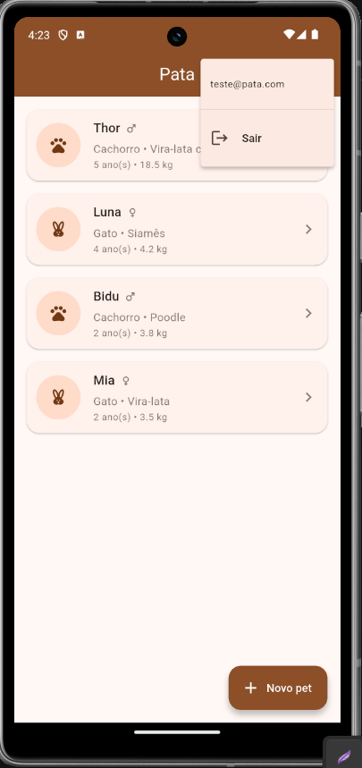

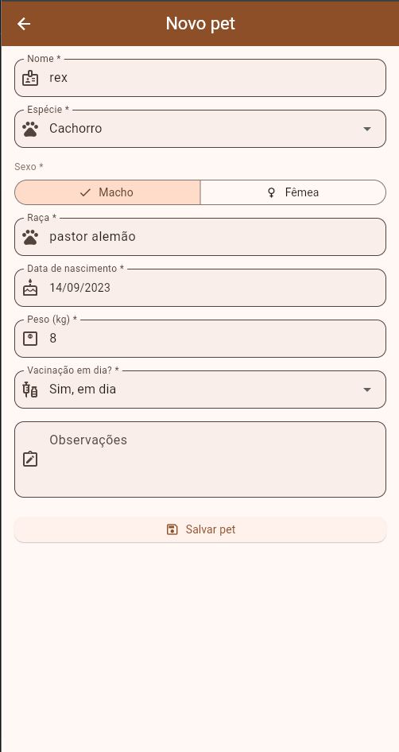

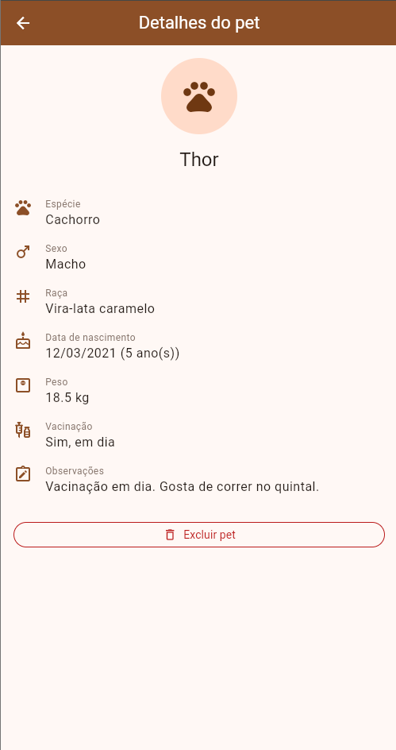

### Funcionalidades adicionadas no Trabalho 2

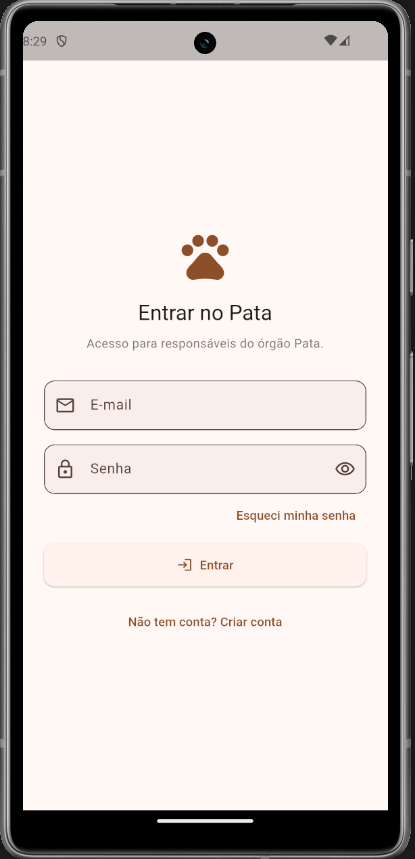

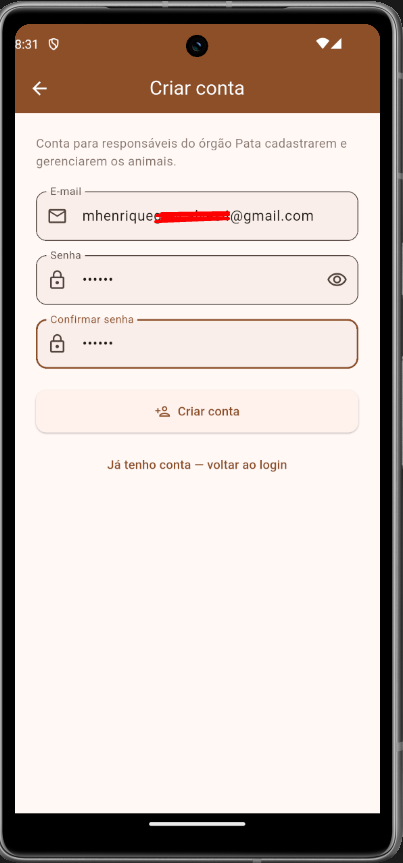

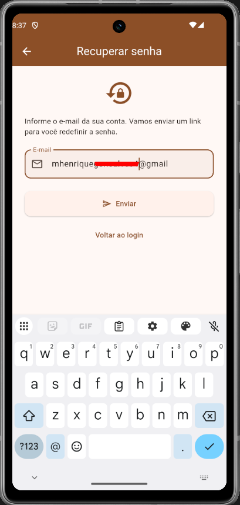

### Funcionalidades adicionadas no Trabalho 3

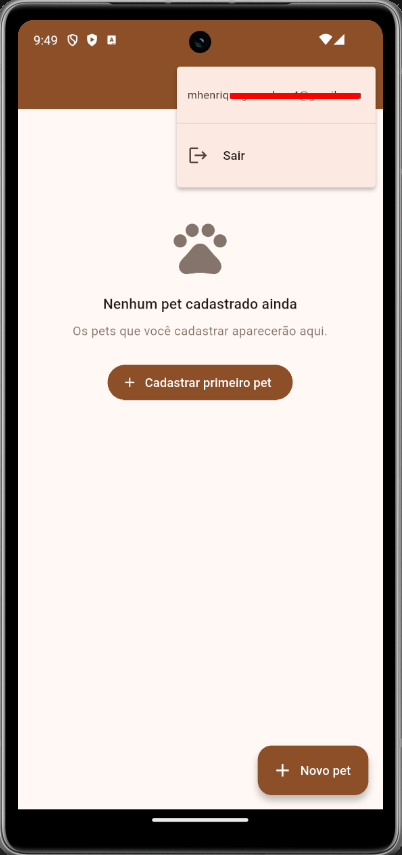

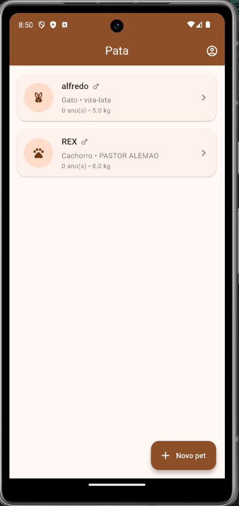

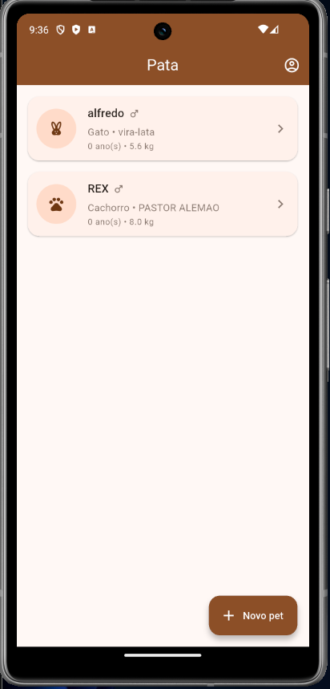

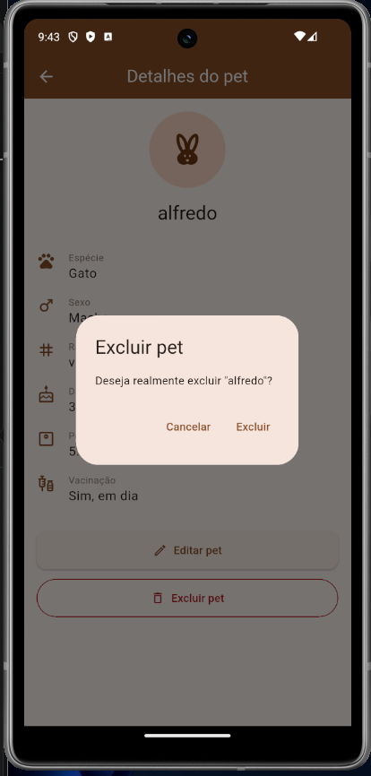

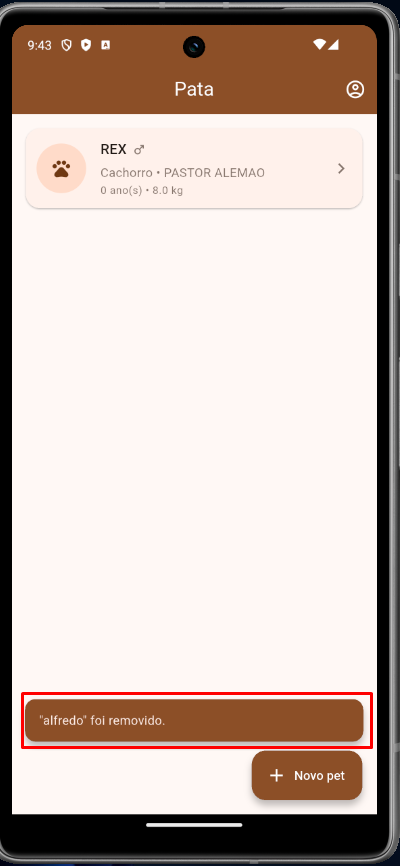

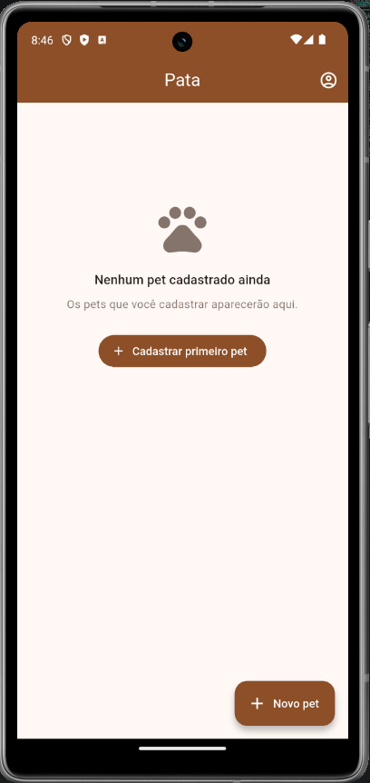

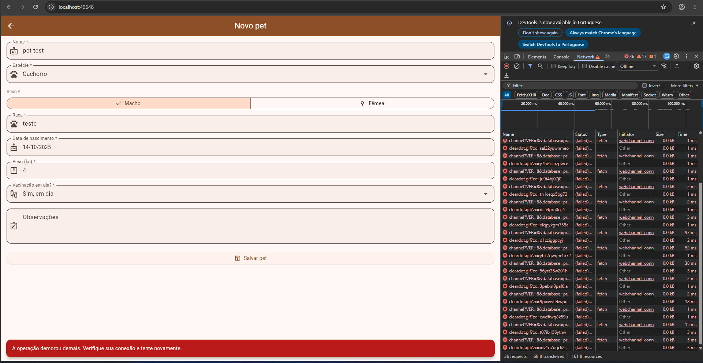

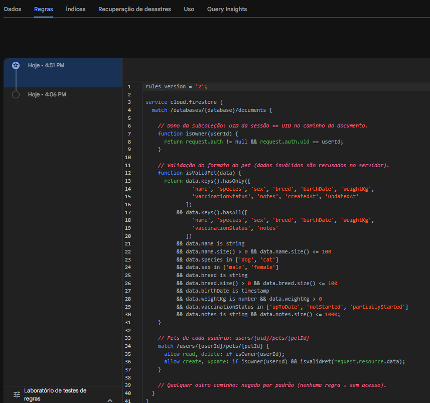

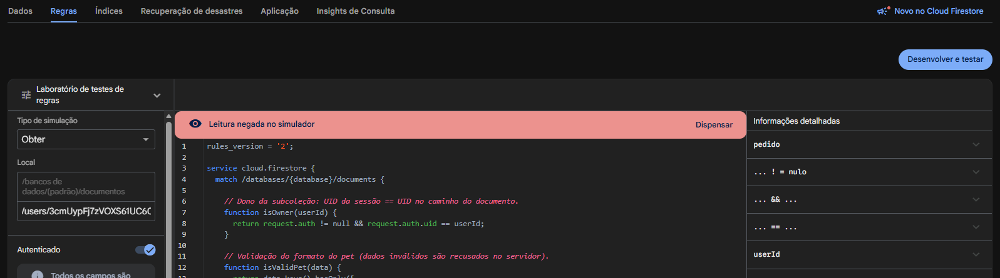

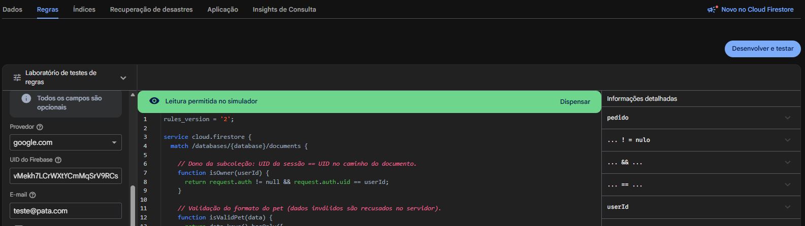

## Próximas evoluções (Trabalho 4)

Versão final do app, com a diferenciação entre responsável do órgão e adotante e a revisão geral do projeto.

## Observações conhecidas

- A diferenciação de perfis entre responsável do órgão e adotante ainda não existe (prevista para o Trabalho 4): todo usuário autenticado gerencia os próprios pets.
- Sem conexão, o Firestore enfileira a escrita; o app interrompe a espera após 15 segundos e avisa o usuário, mas a operação pode ser aplicada quando a conexão voltar.
- O pacote firebase_auth não roda no target Windows desktop; use Chrome ou Android para testar o fluxo de autenticação.